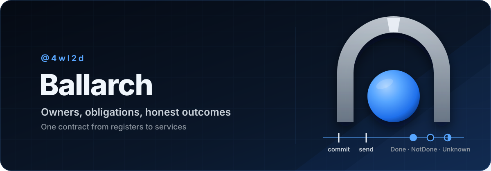

<h1 align="center">Ballarch</h1>

<p align="center">
  <a href="spec/ballarch-core-2.0.md">
    
  </a>
</p>

<p align="center">
  <strong>Owners, obligations and honest outcomes: one architecture from registers to services.</strong>
</p>

<p align="center">
  <a href="docs/tutorial.md">Write your first feature</a> ·
  <a href="docs/interpretations.md">Ballarch at every level</a> ·
  <a href="docs/problems.md">Problems it addresses</a> ·
  <a href="benchmark/results/RESULTS.md">Benchmark</a> ·
  <a href="spec/ballarch-core-2.0.md">Core specification</a> ·
  <a href="paper/">Paper</a> ·
  <a href="docs/ru/README.md">По-русски</a>
</p>

**Ballarch Core 2.0** is an architecture for components that own state and talk to systems that can fail: services, user interfaces, firmware and hardware blocks.

- Each piece of mutable state has one owner, a *Ball*. A Ball decides in pure functions, and a runtime commits its decisions atomically.
- Every outbound request is an *obligation* that ends in exactly one honest outcome: `Done`, `NotDone` or `Unknown`.
- Which outcome is possible follows mechanically from two boundaries in time, the **commit horizon** and the **send horizon**, and from the port's effect class.

The [specification](spec/ballarch-core-2.0.md) is a release candidate (`2.0.0-rc.1`). Ballarch was called Pokeball up to Core 1.5; see the [migration guide](docs/migration-from-1.5.md).

## What is new

Ballarch keeps the established parts of earlier styles:

- single owners (actors, aggregates);
- pure steps (Elm, Decider);
- commit then dispatch (transactional outbox);
- adapters at the edge (Hexagonal and Clean Architecture).

Most of what it adds is known in some form. What is new, as far as the author could establish, is where Ballarch puts it: in the architecture, as rules with checks, rather than in each feature, transport or client. Four elements are new in this sense ([Core §12](spec/ballarch-core-2.0.md#12-lineage-and-what-is-new-informative) gives the prior art for each):

1. **Boundaries in time.** Layers and hexagons constrain *where* code may depend; the commit horizon and the send horizon constrain *when* effects and knowledge may cross. Before the send horizon, non-occurrence is provable. After it, only evidence about every attempt (an answer, a refusal, or an adapter's proof of non-application) or reconciliation can settle what happened to an effectful call. The instants themselves are known from transaction processing, outboxes, transport protocols and durable-execution engines; Ballarch makes them boundaries that every implementation, at every level, must make observable.
2. **One runtime rule for outcomes, across every port.** HTTP, HTTP/2 and gRPC already decide per request whether a retry is safe from whether it was sent or processed and whether it is idempotent, and interface languages such as protobuf and Smithy annotate operations with these classes. Ballarch makes the decision once, in the runtime, for every port: the outcome follows from the call's durable phase and the port's effect class, survives restarts, and reaches the decider as a typed `Done`, `NotDone` or `Unknown`. It is never `NotDone` without evidence, and a `NonIdempotent` call is never re-sent.
3. **Knowledge of composites, with closure.** Transaction managers already merge participants' heuristic outcomes and pass one merged outcome up through interposed coordinators. Ballarch's algebra over Kleene's three-valued logic refines that merge into seven values (Done, NotDone, Partial, NotAllDone, SomeDone, Unknown, NoEffects), counts only absorbing compensations, and counts every call that may still be made as unknown. A composite that replies with its settled knowledge offers its caller what a single call offers, so it can be used one level up as one component. Soundness, and exactness for independent calls, follow from known properties of Kleene's logic.
4. **One rule set, checked at three levels.** The call-protocol rules and the knowledge algebra are checked by bytecode rules and trace oracles in a [JVM service](reference/kotlin/), by power-loss exploration and a purity lint in [firmware](reference/c/), and by lint, netlist checks and fault-injecting benches in [RTL](reference/rtl/). Nested composition is checked at one level, by an itinerary Flow that books two trip Flows. No reference composes different levels, such as firmware behind a service port, so composition across levels is not tested. [Core §11](spec/ballarch-core-2.0.md#11-interpretation-across-levels-informative) lists each level's checks, and the [levels guide](docs/interpretations.md) interprets further levels, from device drivers to smart contracts, without reference code.

## Evidence

| What | Result |
|---|---|
| [Benchmark](benchmark/results/RESULTS.md): one checkout in six styles, 2,000 runs per cell | Idiomatic layered, actor, MVU and outbox-plus-saga versions double-charged or reported charged orders as failed in 12–73% of runs. Ballarch and a layered version hardened by hand violated no requirement. Ballarch cost 29% more code, 45 framework types against 6, lower class cohesion, higher cyclomatic complexity (68 against 49 in total) and a larger distance from the main sequence (0.44 against 0.35). It had the lowest propagation cost and 88% of its code in pure classes. |
| [Alloy model](formal/alloy/obligations.als) of the call protocol | 6 safety properties and 1 liveness property hold within bounds; 6 seeded runtime bugs each yield a counterexample |
| [Conformance traces](tools/TRACE-FORMAT.md) | The runtime's explorations write traces in a language-neutral format; [`tools/oracles.py`](tools/oracles.py) checks them for the trace properties T3 and T5–T9. 46 traces pass; 10 traces with a seeded violation each fail |
| [Knowledge algebra](reference/kotlin/ballarch-kernel/src/test/kotlin/ballarch/kernel/KnowledgeTest.kt) | Soundness and coordinate-wise exactness checked exhaustively for up to four constituents with at most one compensation each (69,905 worlds), and for up to three with up to two compensation attempts each (127,551 worlds). The C implementation is checked on the same 69,905 worlds and on 5,421,361 worlds for claims made before the end |
| [Trip example](reference/kotlin/examples/trip/) | 6,438 runs under every explored fate, late delivery and crash point: neither a status the trip held at any step nor its settled knowledge contradicts the real bookings. A two-valued status is wrong in 1,190 of the 6,435 settled runs, all of them runs in which the trip gave up compensating. Without the providers' fence, 115 settled claims are false |
| [Itinerary example](reference/kotlin/examples/itinerary/) | A Flow inside a Flow: an itinerary books two trips through the trip's port and adds their settled replies. No false claim in 130,321 runs with every fate of the trip's exploration, or in 29,774 runs with faults and crashes. Reading each trip's reply as "done or not" is wrong in 43,170 runs of the first exploration and 20,167 of the second |
| [Firmware reference](reference/c/) | One fault at every power-loss point and NVM write, including torn and failed writes, and the link fates of the first 6 or 7 transmissions: 937,229 runs of a dosing controller and 982,599 of a two-valve transfer, no violation. The transfer's claims and status replies admit the valves' final positions (R14). 47 seeded bugs caught in 52 checks |
| [RTL reference](reference/rtl/) | 8,764 fault scenarios at each of three parameter sets for a command issuer, and 1,458 for a composite whose status register holds its knowledge (R14): every check passes. 28 seeded bugs caught. Netlist checks of single drivers, flip-flops as the only storage, one clock edge and registered outputs, each with fixtures it must reject |

None of this establishes production reliability or team productivity. The runtime's durable store is a single-node file store, tested against killed processes but not power loss. Under the Durable profile the runtime refuses to start on records that new code cannot serve ([Core §6.1](spec/ballarch-core-2.0.md#61-evolution)), but it does not prevent two runtimes from owning one instance during a rolling deploy. The benchmark is small and was written by one author. [Core §10](spec/ballarch-core-2.0.md#10-trade-offs-and-known-limitations) and the [decision guide](docs/decision-guide.md) list the costs and what was not measured. [Problems Ballarch addresses](docs/problems.md) maps twelve recurring failures of today's architectures to the mechanism, rule and evidence for each, and lists what Ballarch does not solve.

## The idea in one example

```kotlin
object OrderDraftBall : Ball<Draft, DraftRequest, DraftReply> {
    override val type = "order-draft"
    override fun initial(key: String) = Draft(quantity = 1)

    override fun decide(state: Draft, request: DraftRequest, ctx: RequestContext) = when (request) {
        is DraftRequest.SetQuantity ->
            if (request.value in 1..20) accept(Draft(request.value), DraftReply.Quantity(request.value))
            else reject(DraftReply.OutOfRange)
        DraftRequest.GetQuantity -> accept(state, DraftReply.Quantity(state.quantity))
    }
}
```

A decision may also contain *outputs*: calls to ports, replies, notices and cancellations. The runtime commits the new state and the outputs atomically, sends nothing before that commit, and later delivers each call's single completion to `complete`. A read (`Safe`) never ends `Unknown`. A card charge (`NonIdempotent`) is never re-sent, and after a timeout or crash it ends `Unknown` rather than a false `NotDone`. The [payment example](reference/kotlin/examples/shop/payments/src/main/kotlin/ballarch/examples/shop/payments/PaymentBall.kt) reconciles after `Unknown`.

## Repository map

| Path | Contents |
|---|---|
| [`spec/ballarch-core-2.0.md`](spec/ballarch-core-2.0.md) | The normative specification: model, boundaries in time, execution semantics, knowledge algebra, rules R1–R14, profiles, conformance, interpretation across levels, lineage |
| [`reference/kotlin/`](reference/kotlin/) | Kernel, reference runtime, test kit, architecture rules, examples, and conformance tests (services) |
| [`reference/c/`](reference/c/) | Firmware runtime, the knowledge algebra in C, and two examples with power-loss exploration: a therapy controller and a two-valve transfer (C11) |
| [`reference/rtl/`](reference/rtl/) | Two hardware Balls, a command issuer and a composite with a knowledge register, with lint, structural checks and fault-injecting benches (SystemVerilog) |
| [`formal/alloy/`](formal/alloy/) | Alloy 6 model of the call protocol |
| [`benchmark/`](benchmark/) | One checkout in six architectural styles, fault injection, and structural metrics |
| [`paper/`](paper/) | The paper (LaTeX) and the publication kit |
| [`docs/`](docs/) | Tutorial, levels guide, problems addressed, decision guide, FAQ, anti-patterns, migration, verification, Russian overview and article draft |
| [`skills/ballarch/`](skills/ballarch/) | An agent skill for feature work (unevaluated) |
| [`tools/`](tools/) | The [conformance-trace format](tools/TRACE-FORMAT.md) and its oracles, and link and snippet checks for the documentation (Python) |

## Try it

Requires JDK 21. From `reference/kotlin`:

```sh
./gradlew build checkModuleBoundaries   # tests, rules, examples, knowledge algebra, conformance traces, benchmark regression
```

Then `make` in [`reference/c`](reference/c/) and [`reference/rtl`](reference/rtl/), and see the [verification guide](docs/reproducibility.md) for the trace oracles, the model, the benchmark and the paper. Start with the [tutorial](docs/tutorial.md).

## License and authorship

Copyright © 2026 **Vladislav Tomilov (4wl2d)**.

Text and diagrams are licensed under [CC BY 4.0](LICENSE); see [NOTICE.md](NOTICE.md). **The code has no software license yet.** A software license remains the copyright holder's decision. Ballarch is not affiliated with Nintendo; the project's former name is not used as a trademark.

Ballarch Architecture by Vladislav Tomilov (4wl2d).
