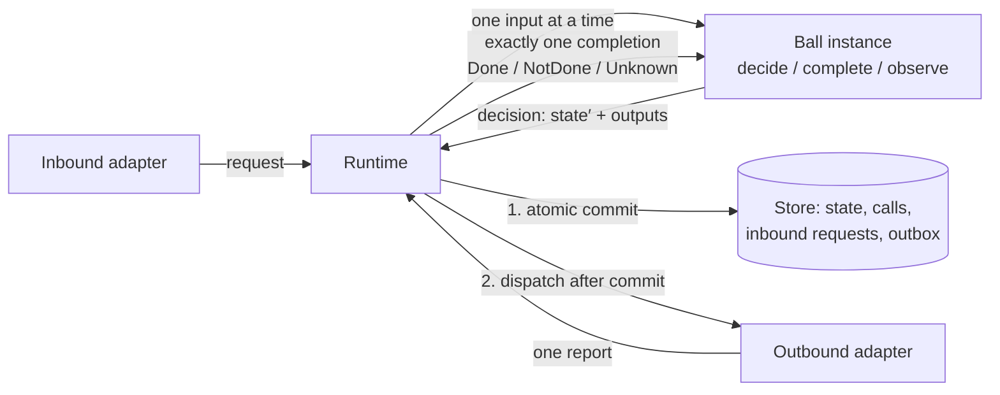
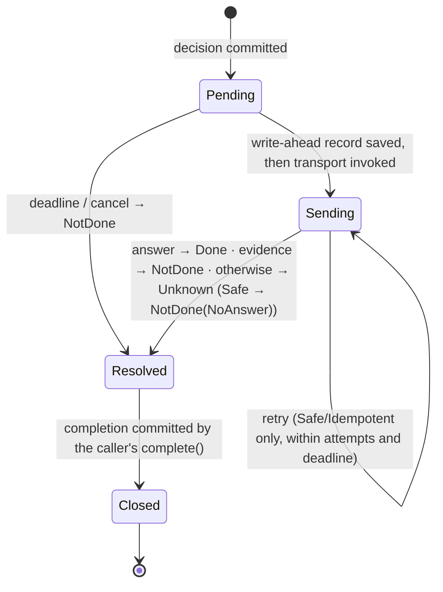

# Ballarch Core 2.0 — Specification

| | |
|---|---|
| **Version** | `2.0.0-rc.1` |
| **Status** | Release candidate for public review. Before `2.0.0`, normative text changes only to correct errors or omissions found in review. |
| **Date** | 2026-10-21 |
| **Supersedes** | Pokeball Core `1.5.0-draft`, published under the project's former name ([published version](https://github.com/4wl2d/Pokeball/tree/1bb9e0ecca4d4d1c8b39327c93988c1b490f303e)); mapping in [`docs/migration-from-1.5.md`](../docs/migration-from-1.5.md) |
| **Reference implementations** | services: [`reference/kotlin/`](../reference/kotlin/) (Kotlin/JVM); firmware: [`reference/c/`](../reference/c/) (C11); hardware: [`reference/rtl/`](../reference/rtl/) (SystemVerilog) |
| **Formal models** | call protocol: [`formal/alloy/obligations.als`](../formal/alloy/obligations.als); knowledge algebra: exhaustive checks in [`KnowledgeTest`](../reference/kotlin/ballarch-kernel/src/test/kotlin/ballarch/kernel/KnowledgeTest.kt) (Kotlin) and [`test_knowledge.c`](../reference/c/test/test_knowledge.c) (C) |
| **Conformance trace** | format: [`tools/TRACE-FORMAT.md`](../tools/TRACE-FORMAT.md); checker: [`tools/oracles.py`](../tools/oracles.py) (§9.6) |
| **Evaluation** | [`benchmark/`](../benchmark/): one feature in six architectural styles under faults |

## 0. How to read this document

Sections 2–7 are **normative**, except for examples, the 'Standard analogue' column of §2, reported results of checks (the bounded results in §4.1 and the test and exploration results at the end of §4.2), and statements about what the reference implementations do; these are informative. Section 8 is **guidance**: recommended practice that a conforming system may ignore with reason. Section 9 defines **conformance**. Sections 1, 10, 11 and 12 are informative. Section 11 interprets the rules for hardware, firmware and services; Section 12 relates the architecture to prior work and states what is new.

The key words MUST, MUST NOT, SHOULD, SHOULD NOT and MAY are to be interpreted as described in RFC 2119 and RFC 8174 when, and only when, they appear in capitals.

Each rule names its **enforcement**: the mechanisms in this repository that check it. Rules in §5.1 bind people who write Balls; rules in §5.2 bind implementers of a runtime. The *Binds* column of §5.3 notes where a rule also binds adapters or authors. "Review" means that no mechanism is provided and the rule, or the named part of it, depends on human judgement.

## 1. Scope

Ballarch Core specifies how the **stateful components** of a system decide, change their state, and interact with each other and with external systems, such that the following hold by construction:

1. every piece of mutable state has exactly one owner, which changes it only by committing its own decisions;
2. no external effect is requested before the decision that requests it is committed;
3. every outbound request ends in exactly one terminal outcome, and that outcome never claims that nothing happened when something may have happened;
4. a crash never splits a decision: its state change and its requested effects are committed together or not at all;
5. a statement about an operation made of several requests never claims more than the outcomes of those requests establish; an owner that answers for such an operation once it is settled offers its caller what a single request offers: one completion, and no claim stronger than the evidence (§7.4).

The rules are stated for any level at which a system has owned state and fallible interactions: a hardware block on a bus, firmware that drives a device, an in-memory UI component, a durable backend service, a workflow across services. The profile (§6) and the mechanisms that check the rules (§9, §11) differ between levels; the rules do not.

**Non-goals.** Ballarch Core does not specify: distributed consensus or replication of a Ball across nodes; exactly-once execution of external effects (only idempotency and reconciliation mechanisms that make at-most-once or effectively-once achievable); multi-Ball transactions; a wire format; a UI toolkit; security isolation between Balls in one process; or a deployment topology.

**Applicability.** The architecture targets components with state that matters and asynchronous or fallible interaction with other components or external systems. For stateless transformations and simple CRUD forms without external effects it adds structure without adding protection (see the measured overhead in §10); use plain code there. [Problems Ballarch addresses](../docs/problems.md) lists the failures of current architectures that these properties target, and the problems they leave open.

## 2. Model

| Term | Definition | Standard analogue |
|---|---|---|
| **Ball** | A single-writer owner of state, addressed by a `BallId` = (type, key). A Ball *type* is defined by a decider; an *instance* by its key. | aggregate (DDD), actor, entity, grain (Orleans) |
| **Decider** | The pure functions of a Ball type: `initial(key)`, `decide(state, request, ctx)`, `complete(state, completion, ctx)`, `observe(state, notice, ctx)`. | Decider (Chassaing), reducer, Elm `update` |
| **Runtime** | Executes Balls: serialises their inputs, invokes deciders, commits decisions, dispatches outputs, tracks obligations. | actor runtime, effect interpreter, "imperative shell" |
| **Port** | A typed request/response contract with an **effect class**, owned by its destination. An *adapter port* is implemented by an adapter; a *Ball port* is served by another Ball. | port (Ports and Adapters) |
| **Adapter** | Code outside every decider that performs requests on an adapter port (outbound) or turns external input into requests (inbound). | adapter (Ports and Adapters), gateway |
| **Effect class** | `Safe` (no effect), `Idempotent` (repeats are deduplicated by the destination), `NonIdempotent` (each delivery may take effect). | RFC 9110 safe and idempotent methods |
| **Composition root** | The one place that lists Ball types, binds adapters to ports, and declares subscriptions. | composition root (dependency injection) |
| **Profile** | What survives a crash: `Transient` or `Durable`. | — |
| **Horizon** | One of two instants that every call crosses in order: the *commit horizon* and the *send horizon* (§2.5). | commit point; output commit; point of no return |
| **Knowledge** | What is established about whether an operation made of several calls took effect (§4.2). | heuristic outcome (XA), `:info` (Jepsen) |



**Legend.** Boxes are components; arrows are the order of operations in one step (§3.1). Deciders never touch the store or adapters; only the runtime does.

### 2.1 Messages

**Inputs** (what a decider receives):

| Input | Meaning | Decider function |
|---|---|---|
| **Request** | Asks the Ball to do something. May be rejected. | `decide` |
| **Completion** | The single terminal outcome of a call this instance made. Cannot be rejected. | `complete` |
| **Notice** | A publication from a subscribed topic. | `observe` |

**Outputs** (what a decision asks the runtime to do after committing it):

| Output | Meaning |
|---|---|
| **Call**(key, port, request, timeout[, target]) | Ask a port to perform a request. Opens an *obligation*. |
| **Reply**(requestId, value) | Answer an earlier accepted request whose reply was deferred. |
| **Publish**(topic, payload) | Publish a notice to the subscribers declared for the topic. |
| **Cancel**(key) | Ask to cancel an open call. |

A `decide` returns **Accept**(state, reply plan, outputs) or **Reject**(reason). The reply plan is *now* (a value) or *later* (a `Reply` output in a later decision). `complete` and `observe` return **Step**(state, outputs).

### 2.2 Outcomes

Every call and every external request ends in exactly one **Outcome**:

| Outcome | Asserts |
|---|---|
| **Done**(value) | The destination processed the request and answered `value`. `value` may itself describe a business refusal that the destination recorded. |
| **NotDone**(reason) | There is evidence that the request had no effect. |
| **Unknown**(reason) | The request may or may not have taken effect. |

A Ball's reply type describes both results and refusals. `Reject(reason)` reaches the caller as `NotDone(Refused(reason))`; `Accept(…, reply)` reaches it as `Done(reply)`.

### 2.3 Context

A decider receives a **context** supplied by the runtime: the instance's `BallId`, the current time (`now`), the revision the decision will commit as, a deterministic generator of call keys, and, for requests, the request identity and the caller (another Ball, or an external principal authenticated by an inbound adapter).

### 2.4 Time

A decider reads time only from the context and waits only by calling the built-in **timer port** `ballarch.timer` (Safe), which every conforming runtime binds. A timer call is made with `Timer.after(key, delay)`; its *due time* is the commit time plus `delay`, and its deadline is the due time plus a fixed margin (1 s in the reference implementation). A timer:

- completes `Done` at its due time, and never before it unless cancelled;
- cancelled before it fires, completes `NotDone(NotApplied)`; cancelled while still `Pending`, `NotDone(Cancelled)`;
- under the Durable profile, survives a restart: it is re-armed to its original due time, or completes `NotDone(NoAnswer)` if the restart comes after its deadline.

A completion of a timer is a wake-up, not a fact about the world: a decider that must not act before some time SHOULD keep that time in its state and compare it with `now`.

### 2.5 Boundaries in time

Architectures usually draw their boundaries in space: layers, modules, services, the hexagon's ports. Ballarch also draws two boundaries in time. Every call crosses them in this order:

| Horizon | The instant | Before it | After it | Rules |
|---|---|---|---|---|
| **Commit horizon** | The atomic commit of the decision that requests the call | The call is part of a decision that can still vanish. Nothing may leave. | The call is an obligation: it will get exactly one outcome, and under the Durable profile it survives crashes. | R4, R5, R6 |
| **Send horizon** | The first moment the request may have left the runtime | The call can be withdrawn truthfully: `NotDone`. | The outcome is `Done`; `NotDone` only with evidence covering every attempt (a refusal by the destination, or an adapter's evidence that the request was not applied), or for a Safe port, which has no effect; otherwise `Unknown`. | R7, R8 |

Between the horizons a call is `Pending`; after the send horizon it is `Sending` (§3.2). The horizons mark where knowledge about an effect changes kind. Before the commit horizon there is nothing to know. Between the horizons, non-occurrence can still be proved. After the send horizon, an effectful call's non-occurrence can be established only by evidence about every attempt (the destination's answer or refusal, or an adapter's proof that the request was not applied) or by later reconciliation.

An implementation MUST make each horizon an event that its checks can observe: under the Durable profile, the commit record and the write-ahead record of §3.2; in a synchronous circuit, the clock edge that commits the request and the bus handshake that hands it over (§11). Spatial boundaries constrain which code may refer to which; these two constrain *when* information and effects may cross.

## 3. Execution semantics

This section defines the observable behaviour of a conforming runtime. A runtime MAY implement it differently if no observer (decider, adapter, requester, or durable store after a crash) can tell the difference.

### 3.1 The instance step

Each Ball instance has an inbox. The runtime repeatedly takes one input from one instance and performs one **step**:

```text
1. input  ← dequeue(instance.inbox)
2. result ← decider function for the input kind (state, input, context)
3. check  ← preflight(result)            # §3.5: bounds, keys, replies, bound ports
4. if the result is Reject, a failed check, or a decider fault:
       commit nothing; answer a request with NotDone(…); a faulty completion/notice quarantines the instance
   else:
       commit(state′, new calls as Pending, replies, notices)   # one atomic write
5. dispatch: deliver replies, publish notices, start pending calls   # only after 4 succeeded
```

Steps of one instance never overlap or nest. Steps of different instances MAY run concurrently if every rule in §5 still holds per instance.

### 3.2 Call lifecycle

A call is identified by `(caller BallId, key)`. Its lifecycle is:



**Legend.** Arrows are runtime transitions of one call. `Pending` and `Sending` are durable phases under the Durable profile; `Resolved` is the runtime's choice of outcome, not yet seen by the decider; `Closed` means the caller committed the completion.

Classification when a call resolves:

| Situation | Safe | Idempotent | NonIdempotent |
|---|---|---|---|
| Destination answered | Done | Done | Done |
| Deadline or cancel while `Pending` (never sent) | NotDone | NotDone | NotDone |
| Adapter reports evidence of non-application, single attempt | NotDone | NotDone | NotDone |
| Same, after more than one attempt | NotDone | retry or Unknown | (not retried) |
| No answer; retries left and time left | retry | retry | Unknown |
| No answer; no retries or no time left | NotDone(NoAnswer) | Unknown | Unknown |
| Durable restart while `Sending` | re-send or NotDone | re-send or Unknown | Unknown |
| Durable restart while `Pending` | send | send | send |

The effect class in this table is the one recorded with the call when its decision was committed; a call on a Ball port records `Idempotent` (§3.4). A runtime MUST classify a call by its recorded class, never by the class its port has in a later binding (§6.1). An attempt ends without an answer when its adapter reports a failure that is not evidence of non-application, or when the call's deadline passes. The Kotlin reference runtime has no timeout per attempt, so an attempt that its adapter never ends lasts until the deadline (§10).

A report that arrives after a call resolved is dropped. The information it carries is not lost to the application only if the application asks again (§8.4).

### 3.3 Inbound request lifecycle

At the receiving instance, a request:

1. is **withdrawn** with `NotDone(DeadlineBeforeSend)` if its deadline passes before it is decided;
2. is **refused** with `NotDone(Refused(reason))`, `NotDone(Overloaded)` or `NotDone(Fault)` if the decider rejects it, a bound is reached, or the decider fails; nothing is committed;
3. is **accepted** otherwise: the reply is delivered as `Done(value)` after the commit, immediately or by a later `Reply` output.

A repeated request with the same request identity is not decided again: it joins the open request, or receives the stored reply, within the retention bound (§3.5). External requests obtain a request identity from an idempotency key; a repeat with the same key and a different message is refused with `NotDone(IdempotencyConflict)`.

### 3.4 Ball-to-Ball calls

A call on a Ball port is delivered as a request to the target instance, with the call identity as its request identity. The target's answer becomes the caller's completion. Because the target deduplicates by request identity, Ball ports are Idempotent and a durable runtime re-sends them after a restart. A Ball never waits synchronously for another Ball.

### 3.5 Bounds and preflight

A runtime MUST enforce finite bounds on at least: inbox length per instance, open calls per instance, outputs per decision, call timeout, attempts per call, unacknowledged notices per publisher, and retained answered requests per instance. Before committing, it MUST reject a decision that:

- reuses the key of an open call, or cancels a call that is not open;
- calls a port that the composition root does not bind;
- replies to a request that is not open, or twice to the same request;
- makes a timer call other than through `Timer.after` (§2.4);
- exceeds a bound (a resource bound on open calls, outputs or notices is overload; a call timeout above its bound is a fault).

A request that arrives when the instance's inbox is full is refused with `NotDone(Overloaded)` without being decided. While deciding a *request*, a decision that would exceed the bound on open calls, outputs per decision or unacknowledged notices refuses the request with `NotDone(Overloaded)`. Any other failed check, including a call timeout above its bound, and any decider failure refuse the request with `NotDone(Fault)` and record a fault. In both cases nothing is committed and the instance continues. Any failed check, or any failure, while deciding a completion or notice quarantines the instance, because obligations it already holds cannot be refused.

### 3.6 Notices

A published notice is committed with the publishing decision and delivered to every subscriber instance selected by the composition root. A subscriber applies notices from one publisher in publication order and at most once. Under the Durable profile, undelivered notices survive restarts and are redelivered.

### 3.7 Crash and recovery

A **crash** stops the runtime abruptly. Under the **Transient** profile, all state, open calls and open requests of the runtime are lost. Under the **Durable** profile, the runtime restarts from the committed records: committed state, open calls with their phases, open and recently answered requests, unacknowledged notices. It then applies the restart rows of the table in §3.2 to each open call according to its recorded effect class, reschedules deadlines, and redelivers notices. Before it recovers, it checks that its composition can serve every committed record (§6.1).

## 4. Formal core

### 4.1 The call protocol

The protocol of §3.2 (commit, write-ahead, send, retry, deadline, crash, recovery, lossy and duplicating network) is modelled in Alloy 6 in [`formal/alloy/obligations.als`](../formal/alloy/obligations.als); [its README](../formal/alloy/README.md) relates the model's transitions to the reference runtime. For the correct protocol, no counterexample to the following exists within the stated bounds (3 calls, traces of up to 14 steps; L1: 2 calls, 12 steps), and each of six seeded runtime bugs yields one ([run the bounded checks](../docs/reproducibility.md#alloy-model)):

| Property | Statement |
|---|---|
| P1 NoSendBeforeCommit | A request is sent only for a call whose decision is committed. |
| P2 OutcomeStable | A call's terminal outcome never changes. |
| P3 NoFalseNotDone | If a call of an effectful port completes `NotDone`, its effect never happens. |
| P4 AtMostOnceNonIdempotent | A NonIdempotent call is sent at most once. |
| P5 DoneIsReal | `Done` is reported only after the destination processed the request. |
| P6 AtomicAcceptance | A caller's committed state and its call ledger agree. |
| L1 EveryObligationCloses | Under fairness (the runtime is eventually up; an enabled deadline eventually fires), every awaited call gets an outcome. |

These are bounded model-checking results, not proofs for all sizes.

### 4.2 Knowledge of composite operations

A Ball often performs one operation through several calls: a booking of a flight and a hotel, a reservation and a charge. What can it truthfully say about the operation as a whole? Ballarch answers with a small algebra over **strong Kleene three-valued logic** (K3), with truth values `Yes`, `No` and `Maybe`.

**Constituents.** Each call the operation may make is a constituent, whether or not the Ball has requested it yet. Its *effect* is a truth value:

- `Yes` if it completed `Done` with an answer that, by the port's contract, means the requested effect happened;
- `No` if it completed `NotDone`; if it completed `Done` with an answer that means the effect did not happen (a business refusal the destination recorded, §2.2); or if the Ball has not requested it and can no longer request it for this operation, for example because the operation is settled;
- `Maybe` if it completed `Unknown`; if it has been requested and has no completion yet, whether or not it has been sent (a `Pending` call may still be sent and take effect); or if the Ball has not requested it but may still do so.

A decider sees no call phases and needs none: these values follow from its own state. If the Ball may make a further attempt at the same effect after a `NotDone`, its attempts, including those it may still make, form one constituent whose effect is the disjunction of theirs.

A call to a port whose reply reports the knowledge of a composite operation (§7.4) is a *composite constituent*. It contributes a pair instead of a single effect:

- the knowledge in its reply, if it completed `Done` with a reply that describes the settled operation;
- `NotDone`, if it completed `NotDone` and no other request, from this Ball or another, could start the same operation (the request had no effect, §2.2, so the operation made no call), or if the Ball has not made it and can no longer make it;
- `Unknown`, if it completed `Unknown`; if it completed `NotDone` but another request may have started the operation, such as an earlier request with the same idempotency key; if its reply describes the operation before it settled; or if it is open or may still be made.

Two replies about the same operation, such as the replies to a request and to its repeat with the same request identity, describe the same effects and are not independent. A caller MUST NOT enter both: it enters one of them, a settled one if it has one.

A *compensation* of a constituent is a call that undoes it. A compensation is **absorbing** if its effect means that no effect of the original request exists or can still take effect, for example because the destination fences the request's reference, or because the original request's *delivery horizon*, the age after which the destination no longer applies it, has passed. The *net effect* of a constituent with absorbing compensations is `effect ∧ ¬undone`, where `undone` is the disjunction of the effects of its compensation attempts. Each attempt counts like a constituent: one that the Ball may still make counts as `Maybe`.

**Knowledge.** The knowledge of an operation is a pair (*all*, *any*): did every constituent take effect (net), and did at least one? For constituents with net effects *n₁ … nₖ*:

*all* = *n₁* ∧ … ∧ *nₖ*,   *any* = *n₁* ∨ … ∨ *nₖ*,

with K3's ∧ and ∨. Composition is a commutative monoid whose identity is the knowledge of an operation with no constituents, (`Yes`, `No`). Exactly seven values can occur:

| Knowledge | (all, any) | Meaning | As one call's outcome |
|---|---|---|---|
| Done | (Yes, Yes) | every effect happened | `Done` |
| NotDone | (No, No) | no effect happened | `NotDone` |
| Partial | (No, Yes) | some effects happened, some did not | `Unknown` |
| Unknown | (Maybe, Maybe) | nothing is established | `Unknown` |
| NotAllDone | (No, Maybe) | not complete; whether anything happened is unknown | `Unknown` |
| SomeDone | (Maybe, Yes) | something happened; whether everything did is unknown | `Unknown` |
| NoEffects | (Yes, No) | the operation requested no effect | `NotDone` |

**Claims over time.** The operation is *settled* when no call for it is open and the Ball will make no further call for it. Counted as above, knowledge is a claim about the operation's *final* effect, the effect once it is settled. Given honest outcomes (§7.4), a completed outcome never changes (P2), a call that completed `NotDone` never takes effect (P3), and `Maybe` admits either value; by monotonicity (below), later completions can therefore refine the knowledge but never contradict it. Once the operation is settled, its knowledge no longer changes. A *snapshot* instead counts a call the Ball has not yet requested as `No`. It describes the effects at the instant it is taken, and a later call may contradict it; R14 limits its use.

**Soundness and exactness.**

- *Soundness.* If the knowledge of every constituent admits what really happened to it, the combined knowledge admits what really happened to the operation.
- *Coordinate-wise exactness.* Each coordinate is the most informative value that every ground truth consistent with the constituents' outcomes satisfies.

Both follow from two properties of K3's strong connectives. They are monotone in the information order, with `Maybe` below `Yes` and `No` (Kleene 1952). On formulas in which every variable occurs once, they coincide with supervaluation (van Fraassen 1966), provided the constituents' calls are independent: every combination of their individually possible effects is jointly possible. *all*, *any* and the net effect `effect ∧ ¬undone` are such formulas. The second property is also why ternary (0/1/X) simulation of logic, used for hazard detection since Eichelberger (1965), is exact on circuits without reconvergent fanout and can be pessimistic with it: `Maybe` behaves like Verilog's `x` under `&`, `|` and `~`.

Soundness and exactness hold for any number of constituents and attempts, because the formulas stay read-once; the exhaustive checks below cover the cases they list. A composite constituent whose reply describes the settled operation enters with `+` like any other. By associativity, the result equals the knowledge of the operation flattened to its single calls.

The exactness is relative to the constituents' individual outcomes. Evidence that correlates constituents, such as "one of these two calls landed", can establish more than the algebra derives. The algebra under-approximates such knowledge and never over-approximates it.

**Evidence.** The kernel's [`Knowledge`](../reference/kotlin/ballarch-kernel/src/main/kotlin/ballarch/kernel/Knowledge.kt) type implements the algebra, and `Outcome.reportedKnowledge` enters a composite constituent's reply as described above. [`KnowledgeTest`](../reference/kotlin/ballarch-kernel/src/test/kotlin/ballarch/kernel/KnowledgeTest.kt) checks exhaustively:

- the connectives against supervaluation;
- the monoid laws on all seven values;
- soundness and exactness for up to four constituents, each with no compensation or one (69,905 worlds), and for up to three constituents, each with up to two compensation attempts (127,551 worlds);
- that the knowledge seen as one call (the last column of the table above) admits the truth in every world;
- for every split of up to four constituents into a settled composite constituent and the rest, that the result equals the flattened knowledge (111,049 splits; this is associativity, not separate evidence), and that an interim reply or a lost call, entered as `Unknown`, still admits every world.

The [trip example](../reference/kotlin/examples/trip/) books a flight and a hotel with absorbing compensations (the providers fence a voided or cancelled reference) and answers the booking request only once the trip is settled. Its exploration, under the Durable profile, gives each booking attempt one of six fates, among them a request that reaches the provider late, gives each compensation attempt one of three, lets the providers run out of seats or rooms, and crashes the runtime before any of the 22 scheduler tasks of the longest run. Of 6,438 runs, 6,435 accepted the booking and settled; in the other 3 the crash came before the booking was accepted.

- In no run did a status the trip held at any step, or its settled knowledge, contradict the providers' final bookings; in all 738 runs in which the reply reached the client, the reply was the settled knowledge.
- 822 booking requests reached a provider after the trip had voided or cancelled them, and the fence absorbed every one. Without the fence, so that compensation is not absorbing, 115 of 7,257 settled runs end with a false settled claim.
- A status of the completions so far, which counts calls still to be made as `No`, was contradicted in 5,920 of the 6,438 runs.
- A two-valued status (booked, or failed in the sense that nothing is held) was wrong in 1,190 of the 6,435 settled runs, all of them among the 5,565 runs in which the trip gave up compensating after two attempts. A status that says "needs attention" for those runs was never wrong; the algebra splits them into `NotAllDone` (2,977 runs), `Unknown` (2,037), `SomeDone` (379) and `Partial` (172).

The example needs the Durable profile (§10).

The [itinerary example](../reference/kotlin/examples/itinerary/) adds a second level: an itinerary Ball books two trips through the trip's port and adds their settled replies with `+`. Under the Durable profile it was explored with every fate of the trip's exploration and the providers' availability, without a crash (130,321 runs), and with four fates per booking attempt, two per compensation attempt and a crash before any of the 42 scheduler tasks of the longest run (29,774 runs, 28,933 of them with a crash). In no run did the itinerary's status or settled knowledge, or a trip's reply as entered, contradict the real bookings. Reading each trip's reply as a Boolean ("the trip is done") instead was wrong in 43,170 of the 130,321 runs and in 20,167 of the 29,771 settled runs of the second exploration. With a call timeout of 2,500 ms, below the trip's worst case of 6,000 ms, 812 of 1,682 calls to a trip ended `Unknown`, and every claim stayed honest.

The algebra is also implemented and checked at the other two levels (§11). In firmware, [`ballarch_knowledge.h`](../reference/c/include/ballarch_knowledge.h) is checked exhaustively on the same 69,905 worlds and on 5,421,361 worlds for claims made before the operation ends. A two-valve transfer with an absorbing compensation uses it: in 982,599 explored runs with power loss, NVM faults and link faults, the claim in every committed state, and the reply a status request would get in that state, admit the valves' final positions. In hardware, a composite block keeps the knowledge of a two-step operation in a status register, two bits per coordinate ([`ballarch_composite.sv`](../reference/rtl/rtl/ballarch_composite.sv)). In 1,458 fault scenarios with 2,916 operations, every value of the register admits the device's ground truth, and its final value equals the knowledge computed by supervaluation. The block is Transient: after a reset its register reads `NoEffects` and covers only operations since that reset. The bench resets the block and the device together before each scenario, never during an operation. At both levels, a seeded bug that counts a call not yet made as `No` produces a false claim.

## 5. Kernel rules

### 5.1 Author rules

**R1 — Single owner.** Each mutable application fact MUST be owned by exactly one Ball instance. A Ball's state MUST change only through the runtime committing that Ball's own decisions. State and message values MUST be immutable.
*Enforcement:* the runtime holds state privately; architecture rules `noGlobalMutableState` and `immutableValues`; ownership boundaries by review (§8.1).

**R2 — Pure decider.** Decider functions MUST be deterministic, terminating functions of their arguments. They MUST NOT perform I/O, read clocks, randomness, the environment or global mutable state, create threads, or use the runtime. Time, identity and new keys MUST come from the context.
*Enforcement:* architecture rule `deciderPurity` (bytecode scan for I/O, networking, databases, concurrency, reflection, ambient clocks and randomness, the runtime); termination by review.

**R10 — Explicit composition.** Balls MUST interact only through calls, replies and notices. A decider MUST NOT reference another Ball's state, decider or runtime. Wiring MUST be declared in a composition root; runtime discovery of handlers or wildcard routing MUST NOT be used. A feature's implementation SHOULD depend on other features only through their public API modules.
*Enforcement:* the kernel gives deciders no access to other Balls; architecture rule `featuresUseOnlyPublicApis`; build check `checkModuleBoundaries`.

**R12 — Read-only queries.** Reading a Ball's committed state (for display or diagnostics) MUST NOT change state or request effects. Reads by another Ball MUST be calls to a Safe port.
*Enforcement:* type system (reads return values, not decisions); `Runtime.watch` observes committed states only.

**R14 — Honest composition.** A Ball that states whether an operation made of several calls took effect, in a reply, a notice, or state that others read, MUST NOT claim more than the knowledge algebra (§4.2) derives from the outcomes of those calls. A constituent counts as `Maybe` while the Ball may still make its call, and while the call is open, whether or not it has been sent; this includes a call requested by the decision that makes the claim. It counts as `No` only once its call completed `NotDone` (or `Done` with an answer that means the effect did not happen), or once the Ball has not made it and can no longer make it for this operation; a composite constituent counts as `NotDone` only in the cases §4.2 lists. The same holds for each compensation attempt, and only an absorbing compensation may count as undoing an effect. A snapshot (§4.2), which counts a call not yet requested as `No`, states the effects at the instant it is taken: it MUST say so, for example by carrying the operation's stage, and MUST NOT be offered as the operation's outcome, for example as the reply to the request that started the operation. Under the Transient profile a crash erases the Ball's calls, so its knowledge covers only calls made since the runtime last started; a claim about effects that outlive a crash needs the Durable profile (§7.4, condition 3).
*Enforcement:* the kernel's `Knowledge` type and `KnowledgeTest`; exploration against ground truth: the trip example, including booking requests that reach a provider after their compensation and a negative control without the providers' fence, and the itinerary example, which composes two levels; at the other levels, the C algebra and the transfer example (firmware) and the composite block's bench (hardware); review, including whether every compensation counted is absorbing and every call the Ball may still make counts as `Maybe`.

### 5.2 Runtime rules

**R3 — Serial processing.** A runtime MUST NOT run two steps of the same instance concurrently or nested.
*Enforcement:* runtime guard; trace property T3 (§9.6).

**R4 — Atomic commit.** A runtime MUST commit a decision's new state together with all its outputs (new calls, replies, notices) in one atomic operation. A rejected decision, a failed preflight, or a decider fault MUST commit nothing. A Durable runtime MUST NOT regenerate committed outputs by re-running decider code (§6).
*Enforcement:* single record replacement in the store; Alloy P6; crash exploration.

**R5 — Commit before dispatch.** A runtime MUST NOT deliver a reply, publish a notice or send a call before the decision that produced it is committed.
*Enforcement:* runtime structure; Alloy P1; trace property T5 (§9.6).

**R6 — One completion per call.** Every committed call MUST have a finite deadline. A runtime MUST deliver at most one completion per call and, while it runs (Transient) or across restarts (Durable), exactly one by the deadline plus scheduling delay. A completion MUST NOT be delivered for a call the instance did not commit.
*Enforcement:* runtime; Alloy P2 and L1; trace property T6 (§9.6).

**R7 — Honest outcomes.** `NotDone` MUST be produced only with evidence of non-application: the call was never sent, the destination refused it, an adapter reported evidence covering every attempt that may have been delivered (for example, HTTP/2's REFUSED_STREAM, or a GOAWAY whose last stream identifier is lower than the request's stream), or the port is Safe and so has no effect to apply. For effectful ports, a call that may have been sent and has no answer MUST end `Unknown`; for Safe ports it ends `NotDone(NoAnswer)`.
*Enforcement:* runtime classification table (§3.2) by the effect class recorded at commit; Alloy P3, P5; trace property T7 against simulated ground truth (§9.6); adapter conformance kit.

**R8 — No blind re-send.** A runtime MUST NOT send a NonIdempotent call more than once, including after a restart; before sending it MUST record durably (Durable profile) that the call may have been sent. Only the runtime MAY retry, within the port's finite attempt budget, and only Safe and Idempotent ports. Adapters MUST NOT retry.
*Enforcement:* runtime write-ahead phases; composition rejects retry policies on NonIdempotent ports; recovery by the effect class recorded at commit, so a port rebound as NonIdempotent does not re-send its open calls (§6.1); Alloy P4 and the `NoWriteAhead` and `ResendAfterCrash` mutants; trace property T8 (§9.6); adapter conformance kit (deliveries per invocation).

**R9 — One reply per accepted request.** An accepted request MUST receive at most one reply. A Ball SHOULD reply to every accepted request before its deadline; a runtime MUST report an accepted request left unanswered past its deadline as an obligation leak and MUST NOT invent a reply for it.
*Enforcement:* runtime preflight; trace event `ReplyOverdue`; trace property T9, which checks the at-most-one half (§9.6).

**R11 — Bounded resources and preflight.** A runtime MUST enforce the bounds and the preflight checks of §3.5 and MUST refuse new work before accepting it rather than drop accepted work.
*Enforcement:* runtime preflight and admission; `RuntimeRulesTest`.

**R13 — Honest profile claims.** A runtime MUST document its profile. A Transient runtime MUST NOT claim that state, open calls or open requests survive a crash. No profile implies exactly-once execution of external effects.
*Enforcement:* documentation review; crash exploration demonstrates both profiles.

### 5.3 Rules summary

| Rule | Force | Binds | Checked in this repository by |
|---|---|---|---|
| R1 Single owner | MUST | author | runtime encapsulation; `noGlobalMutableState`, `immutableValues`; C purity lint (no writable section); Yosys single-driver check |
| R2 Pure decider | MUST | author | `deciderPurity` (not termination); C purity lint (object file, preprocessed source, clang AST); Yosys latch and storage checks |
| R3 Serial processing | MUST | runtime | runtime guard; trace property T3 |
| R4 Atomic commit | MUST | runtime | store design; Alloy; crash exploration; C power-loss and NVM-fault exploration (torn and failed writes); Yosys clock-edge and asynchronous-pin checks |
| R5 Commit before dispatch | MUST | runtime | Alloy; trace property T5; C exploration; RTL bench; Yosys path check |
| R6 One completion per call | MUST | runtime | Alloy; trace property T6; C exploration; RTL bench, including phase deadlines |
| R7 Honest outcomes | MUST | runtime, adapter | Alloy; trace property T7 with ground truth; conformance kit; C exploration; RTL bench |
| R8 No blind re-send | MUST | runtime, adapter | Alloy; trace property T8; composition check; recovery by recorded effect class; conformance kit; C exploration; RTL bench |
| R9 One reply per request | MUST / SHOULD | runtime / author | preflight; trace property T9; `ReplyOverdue` in the trace |
| R10 Explicit composition | MUST / SHOULD | author | kernel API; `featuresUseOnlyPublicApis`; `checkModuleBoundaries` |
| R11 Bounded resources and preflight | MUST | runtime | preflight; `RuntimeRulesTest`; C runtime tests |
| R12 Read-only queries | MUST | author | types |
| R13 Honest profile claims | MUST | runtime | review (no mechanism); crash exploration demonstrates both profiles |
| R14 Honest composition | MUST | author | `Knowledge`, `KnowledgeTest`; trip and itinerary explorations; C algebra check and transfer exploration; RTL composite bench; review |

## 6. Profiles

| Profile | Survives a crash | Guarantees beyond §5 |
|---|---|---|
| **Transient** | nothing | none; a crash loses state, open calls and open requests together, so no half-applied decision is visible. A Ball's knowledge (R14) covers only calls made since the runtime last started. |
| **Durable** | committed state, call ledger with phases, open and recently answered requests, unacknowledged notices | R6 across restarts; NonIdempotent calls possibly in flight at a crash end `Unknown(RecoveredAfterCrash)`; Idempotent and Ball-port calls are re-sent; timers are re-armed to their due time; notices are redelivered and deduplicated. |

A Durable runtime MAY store state as snapshots or as events folded by an `evolve` function. It MUST commit events and outputs atomically (R4) and MUST NOT regenerate outputs by replaying current decider code. The reference runtime implements snapshots only, kept in memory (`MemoryStore`) or in one file per instance committed by atomic rename (`FileStore`). A `FileStore` file holds the record's identity ahead of the codec's bytes, so a record that cannot be decoded is named, and it can still be listed and deleted (§6.1).

### 6.1 Evolution

A Durable runtime restarts from records that earlier code committed, so a deploy changes the code while obligations are open. Under the Durable profile:

1. Each Ball type has a *state version*, at least 1: the version of the state shape it commits. It MAY supply a pure function `migrate(fromVersion, state)` that converts a state committed under another version. The runtime MUST store the version with each committed state and, on load, MUST convert a state of another version with `migrate` or refuse to start (item 3). The record keeps the old shape until the instance next commits.
2. The runtime MUST store with each call the effect class its port had when the call was committed, and MUST classify the call by that class in retries, deadline outcomes and recovery (§3.2, §3.7), never by the port's current binding. The attempt budget after a restart is that of the current binding. So a call committed as Idempotent that may have been sent, on a port since rebound as NonIdempotent, is not sent again: it ends `Unknown(RetriesExhausted)`. A call committed as NonIdempotent that may have been sent ends `Unknown(RecoveredAfterCrash)`, even if its port is now Idempotent.
3. Before it writes anything, the runtime MUST refuse to start if the store holds a record that it cannot read, a record of a Ball type that the composition root does not register, a state version that its Ball type cannot migrate, an open call on a port that the composition root does not provide (an adapter port it does not bind, or a Ball port of a type it does not register), or an undelivered notice for a subscription that the composition root does not declare. The refusal SHOULD name every offending record. To remove a Ball type, a port or a subscription, first drain its records, open calls or notices under a composition that still provides it.
4. A deployment MUST NOT let two runtimes own one instance at the same time. This binds the operator, not the runtime, which MAY detect it. A rolling deploy therefore needs a handover outside this specification.

A completion or notice that the new decider no longer handles is a decider failure (§3.5): it quarantines the instance when it arrives. The check of item 3 does not detect it.

The reference runtime implements items 1–3 with `Ball.stateVersion` (default 1) and `Ball.migrate` (the default accepts only the current version), the effect class in each call record, and a check in the `Runtime` constructor. The check throws `IncompatibleStoreException`, with one problem per offending record, before the runtime writes anything, including its incarnation counter. To retire a Ball type, an operator drains its records under a composition that registers it and then deletes them with `Store.delete`, which the runtime itself never calls; deleting a record that still holds obligations loses them. A codec must still read the classes of committed records: with the default `JavaSerializationCodec`, every application class in a record keeps a fixed `serialVersionUID` and changes only in ways Java serialization accepts. [`EvolutionTest`](../reference/kotlin/ballarch-runtime/src/test/kotlin/ballarch/runtime/EvolutionTest.kt) checks these behaviours. Neither reference store detects a violation of item 4.

## 7. Composition

### 7.1 Module structure

A feature SHOULD be split into:

- an **API module**: its Ball port, request and reply types, topics and public payloads; it depends only on the kernel;
- an **implementation module**: its decider and private adapter ports; it depends on the kernel and on API modules;
- **adapters**, which depend on the runtime and on external libraries;
- one **composition root** (application module), the only module that depends on every implementation.

### 7.2 Workflows

A multi-step interaction among several Balls whose progress, compensation or terminal outcome must survive a crash SHOULD be owned by one Ball whose state is the workflow (a *Flow*). Participants SHOULD make the requests a Flow repeats idempotent (keyed by the workflow identity), so that a Flow can repeat a step whose outcome is `Unknown`.

### 7.3 Cycles

Call cycles between Balls are permitted: no step waits for another, so a cycle cannot deadlock or re-enter a decider. Feedback loops are bounded only by R11; a design SHOULD give every loop an explicit termination condition.

### 7.4 Composition closure

A Ball that performs an operation for the requests on its port can answer for it as a single call does, under four conditions:

1. the outcomes it receives are honest: its runtime and adapters conform (§9.1, §9.3), and each Ball it calls for the operation satisfies this section;
2. every compensation it counts as undoing an effect is absorbing (§4.2);
3. it keeps its state and call ledger for as long as the effects of its calls persist: under the Durable profile, or under the Transient profile only if a crash also clears those effects;
4. it obeys R14, so that every call it may still make for the operation, including a compensation, counts as `Maybe`.

Then every claim it derives about the operation, other than a snapshot, admits the operation's final effect, when it is made and at every later time (§4.2). The Ball SHOULD answer a request for the operation only once the operation is settled, with a deferred reply (§2.1) that carries the settled knowledge. Such a reply offers the caller what a single call offers:

- one completion per request: the Ball replies at most once (R9), and the caller's runtime delivers exactly one completion by the caller's deadline (R6);
- no claim stronger than the evidence: the reply's knowledge admits the operation's final effect (R7, R14), and it no longer changes.

One level up, the caller enters the reply's knowledge as a composite constituent of its own operation (§4.2). By associativity, its knowledge then equals what it would derive from all the calls below it, so, by induction, the same holds at any depth of composition. The itinerary example explores two levels against the real bookings (§4.2).

A status given before the operation settles, such as the answer to a status query, either counts every call the Ball may still make as `Maybe`, and is then usually `Unknown`, or is a snapshot: it states the effects at the instant it was made, and a later completion may contradict it. A caller counts any reply that does not describe the settled operation as `Unknown` (§4.2).

The closure stays sound but can lose information in two places. A caller whose deadline is shorter than the time the operation needs to settle receives `Unknown` (as in the itinerary's timeout exploration, §4.2); its deadline SHOULD cover the operation's worst case. A composite that reports only a three-valued outcome (the last column of the table in §4.2) is still honest, but `Partial`, `NotAllDone` and `SomeDone` all become `Unknown`; a composite that can end with a partial effect SHOULD therefore return its knowledge in its reply type.

The same argument applies across levels. A register block, the firmware that drives it, the service that calls the firmware and a workflow across services can each be described by the same rules, each level treating the one below as Balls behind ports. The references in this repository check the rules, including the knowledge algebra, at each level separately; none composes levels, so no check covers a service whose call is served by firmware or hardware (§11).

## 8. Guidance (non-normative)

**8.1 Ownership boundaries.** Put facts that must change together under one invariant in one Ball; separate facts with independent lifecycles, owners, consistency or load. A Ball is too large if it becomes a throughput bottleneck for one key or needs many unrelated message types; too small if a single invariant spans Balls.

**8.2 Inputs from the outside world.** Parse and validate representation at the inbound adapter; decide business rules in the decider. Authenticate callers in the adapter and pass the principal in the context; decide permissions in the decider.

**8.3 Stale results.** Store the key of the call whose completion may change what is shown; ignore completions with any other key. Cancel superseded calls to save work, not for correctness.

**8.4 Reconciliation.** When a NonIdempotent call ends `Unknown`, wait until the destination's delivery horizon has passed, then ask a Safe status port. Prefer destinations that accept idempotency keys: they turn the port Idempotent and make most `Unknown` outcomes disappear after retries.

**8.5 Status of long operations.** Keep the operation's status in its owner's state and answer status requests from it; build separate read models from notices only when load requires it.

**8.6 Security.** Adapters hold capabilities (credentials, clients) and use parameterised or structured sinks; deciders hold none. Keep secrets out of state, messages and traces. Treat every inbound and every adapter response as untrusted input.

**8.7 Testing.** Test deciders as plain functions. Test the runtime and adapters with fault injection against ground truth. Run the architecture rules in the build.

## 9. Conformance

### 9.1 A conforming runtime

A runtime conforms to Core 2.0 if, for the profiles it claims, it satisfies R3–R9, R11 and R13 and every other requirement stated with MUST or MUST NOT in Sections 2, 3 and 6 that binds a runtime, including the timer port of §2.4, the observable horizons of §2.5, the deduplication of §3.3 and, for the Durable profile, items 1–3 of the evolution rules of §6.1 (item 4 binds the deployment). Evidence consists of:

1. conformance traces in the format of §9.6, recorded under exhaustive or seeded fault and crash exploration of at least the scenarios in [`ExplorationTest`](../reference/kotlin/ballarch-runtime/src/test/kotlin/ballarch/runtime/ExplorationTest.kt) (a NonIdempotent, an Idempotent and a Safe port; a NonIdempotent port under the Transient profile, also with new work after a restart; a call between Balls; notices), that [`tools/oracles.py`](../tools/oracles.py) accepts with exit status 0. The Kotlin `Oracles.check` in [`ballarch-testkit`](../reference/kotlin/ballarch-testkit/) implements the same properties and reports the same messages, with R in place of T;
2. the boundary behaviour specified by [`RuntimeRulesTest`](../reference/kotlin/ballarch-runtime/src/test/kotlin/ballarch/runtime/RuntimeRulesTest.kt) and, for the Durable profile, the evolution behaviour of §6.1 specified by [`EvolutionTest`](../reference/kotlin/ballarch-runtime/src/test/kotlin/ballarch/runtime/EvolutionTest.kt); and
3. a correspondence between its call lifecycle and the transitions of the Alloy model of §4.1 (commit, markSending, send, retry, receive, timeout, crash, recover). For the Transient profile the correspondence covers executions without a crash, since a Transient crash ends the instance together with its calls (§6). [`formal/alloy/README.md`](../formal/alloy/README.md) gives it for the reference runtime.

### 9.2 A conforming application

An application conforms if its Balls satisfy R1, R2, R10, R12 and R14 and run on a conforming runtime. Evidence consists of the architecture rules of [`ballarch-archrules`](../reference/kotlin/ballarch-archrules/) passing on its code, exploration tests of its composite operations against ground truth, and review of ownership boundaries, decider termination, the absorbing property of compensations, and the counting of calls a Ball may still make (R14).

### 9.3 A conforming adapter

An adapter conforms if it reports each invocation at most once, never retries, reports non-application only with evidence, and uses the call identity as the idempotency key where the destination supports one. Evidence is the adapter conformance kit.

### 9.4 Conformance at other levels

A firmware or hardware implementation is a runtime and the Balls it runs at once. It conforms if, for the profile it claims, it satisfies every rule of §9.1 and §9.2 that applies to an element it has, and it lists the elements it lacks together with the rules that therefore do not apply (for example, a block with no deferred replies has nothing for R9's overdue report to check). The evidence is specific to the level; neither reference below emits the conformance trace of §9.6. The firmware reference, which is Durable, does not implement the evolution rules of §6.1: its call record stores no effect class, so it classifies an open call by its current port table, and its start-up check compares only a layout fingerprint. On a record of another layout it quarantines the instance, writing nothing, instead of refusing to start, and names no record. §10 states what a firmware update must therefore do. The hardware reference is Transient, so §6.1 does not apply to it. The references in this repository check the subsets listed in §11:

- for firmware ([`reference/c/`](../reference/c/)): bounded exhaustive exploration against the device's ground truth, with one fault at each power-loss point and NVM write (including torn and failed writes) and the link fates of the first transmissions, including retries (R4–R8); deterministic tests of preflight, bounds, retries and quarantine (R11); a lint of the decider's object file, its preprocessed source and, with clang, its syntax tree (R1, R2; necessary, not sufficient); and an exhaustive check of the C knowledge algebra and a composite example whose committed claims and status replies are checked against ground truth (R14);
- for hardware ([`reference/rtl/`](../reference/rtl/)): fault-injecting simulation against the device model (R5–R8, and R14 for a composite block whose status register holds the knowledge of its operation), lint, parameter-range checks, and structural netlist checks of single drivers (R1), flip-flops as the only storage and no latch (R2), one rising clock edge for all state with no input reaching an asynchronous pin (R4), and registered outputs (R5).

### 9.5 Claims

A claim about a system built with Ballarch (durability, delivery, recovery time, throughput) MUST name the profile, the runtime, the scenario and the evidence. Conformance to this specification is not by itself such a claim.

### 9.6 Conformance trace

A conformance trace records one run of a runtime under a simulated environment: the events the runtime emitted, and what really happened at the simulated destinations (the *ground truth*). Its format is JSON Lines, so a runtime in any language can produce it and one checker can judge it. [`tools/TRACE-FORMAT.md`](../tools/TRACE-FORMAT.md) defines version 1 in full, with the encoding of each value, the exact messages and an example. This section states what conformance relies on.

**Lines.** A trace is UTF-8 text with one JSON object per line, each with a string field `event`. The first line is `Header` (`format` `"ballarch-trace"`, `version` 1, `profile` `"Durable"` or `"Transient"`). The last is `End` (`quiescent`: whether the run stopped because no work was left); a trace without it is incomplete. Runtime events follow in the order the runtime emitted them, each with `at` (the runtime clock in milliseconds) and `epoch`:

| Event | Further fields | Emitted when |
|---|---|---|
| `DecideStarted` | instance, input | a decider function starts |
| `DecideFinished` | instance | it returns or throws |
| `Committed` | instance, revision, newCalls, completedCall, completedOutcome, replies, published | a decision is committed, before any of its outputs is dispatched; `completedCall` and `completedOutcome` name the completion it consumed |
| `CallSent` | call, port, attempt | the record that an attempt may have been sent is saved, before the transport runs: the send horizon |
| `CallResolved` | call, outcome | the runtime chose the call's outcome |
| `LateReportDropped` | call, report | a report for a call already resolved or closed was dropped |
| `RequestRejected` | instance, request, outcome | a request was refused before acceptance |
| `Replied` | instance, request, outcome | a reply to an accepted request is delivered |
| `Fault` | instance, message | a decider threw or broke a kernel rule; nothing was committed |
| `ReplyOverdue` | instance, request | an accepted request is still unanswered at its deadline |
| `Recovered` | incarnation, instances | the runtime finished its start-up recovery |

An outcome carries its kind and reason (§2.2); a call is identified by its caller and key (§3.2). Application values (states, messages, reply values) are not part of the format, and no property depends on the free-text fields (`input`, `message`, `report`, an outcome's `detail`). Readers ignore fields they do not know; an unknown event is an error.

**Ports and ground truth.** A call to another Ball has the port `ball:<type>`, and a timer the port `ballarch.timer` (§2.4). Every other port is an *adapter port*, and in a conformance run every adapter port is bound to a simulated destination. The environment, not the runtime, writes one `Destination` line (epoch, call, effectClass, deliveries, processed, applied) for each call with a `CallSent` on an adapter port in an epoch. It records the call from the moment an attempt is handed to it, with the counts at the end of the run, so a call whose every request was lost has a line with 0 deliveries. A trace is valid only if:

- **G1:** every `Destination` epoch is an epoch of the trace;
- **G2:** each call with a `CallSent` on an adapter port has exactly one `Destination` line in that epoch;
- **G3:** each `Destination` line's call has a `CallSent` on an adapter port in that epoch.

**Epochs.** Under the Durable profile every runtime event has epoch 0: a restart continues one world, with the same call identities and the same ground truth. Under the Transient profile a restart begins a new world in which state is empty and call identities may repeat. The first runtime event has epoch 0, and each `Recovered` that is not the first runtime event starts the next epoch. A `Destination` line carries the epoch of the runtime that sent the call; a delivery that arrives after a crash still counts there.

**Properties.** A conforming runtime's traces MUST satisfy the following. Under the Transient profile, T5–T9 are judged on each epoch separately, against that epoch's ground truth.

| Property | Rule | Statement |
|---|---|---|
| T3 | R3 | Between `DecideStarted(i)` and the next `DecideFinished(i)` or `Recovered`, no other `DecideStarted(i)` occurs, over the whole trace. |
| T5 | R5 | Every `CallSent(c)` is preceded, in its epoch, by a `Committed` whose `newCalls` contains `c`. |
| T6 | R6 | Each call is the `completedCall` of at most one `Committed` in its epoch. If the run is quiescent, every call in some `newCalls` of an epoch that owes liveness is completed exactly once: under the Durable profile the single epoch, under the Transient profile only the last. |
| T7 | R7 | For each `Committed` whose `completedCall` has a `Destination` line in its epoch: if the outcome is `NotDone` and the effect class is not Safe, the effect was applied 0 times; if it is `Done`, the destination processed the call. |
| T8 | R8 | A call whose `Destination` effect class is NonIdempotent has at most one `CallSent` in its epoch, and its effect was applied at most once. |
| T9 | R9 | Each pair of instance and request occurs in at most one `Replied` of its epoch. |

The properties do not cover R4, which crash exploration shows; R11 and R13; completion by the deadline; or the half of R9 that asks for a reply, which appears as `ReplyOverdue`. T7 and T8 judge only calls on adapter ports. The properties are checked on the runs explored, and hold for other runs only as far as the exploration covered them.

**Checker.** [`tools/oracles.py`](../tools/oracles.py) needs Python 3.8 or later and only its standard library. It prints one line, `TRACE: MESSAGE`, per violation and exits with 0 if every trace satisfies every property, 1 if one is violated, and 2 if a file is not a valid trace; with `--expect-violations`, every trace must violate a property. In the Kotlin reference, `TraceJson.write` and `Harness.writeTrace` in `ballarch-testkit` write traces and refuse ground truth that does not match the calls sent. The build writes 46 traces from explorations and clean runs, all of which must pass, and 10 traces with one seeded violation each, all of which must fail ([commands](../tools/TRACE-FORMAT.md#checking-a-trace)).

## 10. Trade-offs and known limitations

**Measured in this distribution.** The [benchmark](../benchmark/) implements one checkout in six styles and runs each 2,000 times per fault profile and crash setting against a provider without idempotency keys ([results](../benchmark/results/RESULTS.md)).

- **Correctness.** Ballarch, and the layered version hardened by hand, violated no requirement in any run. The idiomatic layered, actor, MVU and outbox-plus-saga versions charged twice or reported charged orders as failed in 12% to 73% of runs.
- **Code size and concepts.** Ballarch's feature code was about 29% larger than the hardened version's (279 against 216 SLOC). It used 45 framework types against 6.
- **Cohesion.** Fewer of its classes were cohesive by LCOM4 (8% with LCOM4 = 1, against 71% for the hardened version), although its mean LCOM4 was slightly better (1.92 against 2.14). Its mean type-based cohesion (CAMC) was lower (0.33 against 0.52).
- **Complexity and package balance.** Its cyclomatic complexity was higher (2.19 against 1.81 per function, 68 against 49 in total), its mean distance from the main sequence was larger (0.44 against 0.35), and its most coupled class had a CBO of 18 against 16.
- **Where it gains.** It had a lower mean CBO than the hardened version (3.94 against 4.70), the lowest propagation cost of the six (13% against 20–31%), 88% of its code in pure classes (against 27% for the hardened version), and no exception handler.

The benchmark is small and was written by one author; see its threats to validity.

**Earlier measurements (not reproducible from this checkout).** The research prototype's comparison measured the following; its data and harness are not part of this distribution:

- the module structure of §7.1 made cross-feature changes touch more files than single-module baselines in 4 of 5 change requests;
- a local request through the reference runtime took a median of 39 µs more than a direct call on the production thread scheduler, almost all of it thread hand-off; the runtime's own work was about 0.5 µs and 1 KB per request.

**Limitations.**

- **Durable writes.** An effectful call needs at least three durable writes under the Durable profile.
- **Throughput.** One instance is one sequential writer (hot keys).
- **Cross-Ball invariants.** An invariant that spans Balls cannot be enforced in one decision; it needs a coordinating Ball, a reservation, or a storage constraint.
- **Information loss.** A late answer after a call resolved is dropped; the application must reconcile explicitly.
- **Quarantine blocks notices.** Notices to a quarantined subscriber stay in the publisher's outbox and are retried until the subscriber's code is fixed and the runtime restarted (quarantine is not persisted). Once the outbox bound is reached, the publisher's decisions that publish are refused with `Overloaded`.
- **Retries need adapters that end attempts.** The Kotlin reference runtime has no timeout per attempt: an attempt ends when its adapter reports, or at the call's deadline. If an attempt's answer is lost and the adapter does not end the attempt, the call waits until its deadline and ends `Unknown` (`NotDone(NoAnswer)` for a Safe port), and the attempt budget of a Safe or Idempotent port goes unused. For retries to help, the adapter must end each attempt itself: report a failure after its own attempt timeout, and ignore a later answer.
- **Transient profile and R14.** Under the Transient profile a crash erases a Ball's calls, and its knowledge covers only calls made since the runtime last started. In the trip example's Transient exploration (2,358 runs), a restarted trip claims nothing (`Unknown`), also in the 635 runs in which a provider still holds a booking, and no claim is false. If the client sends the booking again, the new trip has forgotten the earlier bookings: in 608 of 3,073 settled runs its settled claim is false, and in 152 runs a flight is booked twice. A Ball whose calls have effects that outlive a crash needs the Durable profile (§7.4, condition 3). The hardware reference's composite block is Transient: its status register covers only operations since the block's last reset, and its bench resets the block and the device together, never during an operation.
- **Evolution.** The start-up check of §6.1 covers unreadable records, unregistered Ball types, state versions that cannot be migrated, open calls on ports that are no longer provided, and undelivered notices for removed subscriptions. It does not detect a new decider that no longer handles completions of a port that is still bound: such a completion quarantines the instance when it arrives. A migration needs a codec that can still read the old classes. Exclusive ownership of an instance during a rolling deploy is not enforced: neither reference store prevents two runtimes from using it at once. The firmware reference does not implement §6.1 (§9.4). Its layout fingerprint covers the record size, the bounds, the Ball type, the state size and `schema`, but not the port table. So a firmware update that changes a port's effect class or the port table must be applied with an empty call ledger, or bump `schema` so that a committed record quarantines the instance instead of being misread. An update that changes the record layout must migrate the record (write it in the new layout with a higher sequence number) or be applied with an empty call ledger and erased slots.
- **Levels checked separately.** Each reference checks its own level (§11): the call-protocol rules at all three, and the knowledge algebra in the service reference, in the firmware reference (its C implementation and the transfer example) and in the hardware's composite block. Composition is checked only within the service level, by the itinerary over the trip. No reference composes levels, so no check covers a service whose call is served by firmware, or firmware that drives a hardware Ball. The firmware and hardware references emit no conformance trace (§9.6).
- **Unchecked obligations.** Termination of deciders, adapter honesty beyond the conformance kit, the absorbing property of compensations, and the choice of ownership boundaries are not mechanically verified.

## 11. Interpretation across levels (informative)

The rules mention no language, no transport and no kind of storage. The same concepts appear at every level where state is owned and interactions can fail:

| Concept | Service (Kotlin reference) | Firmware (C reference) | Synchronous hardware (RTL reference) |
|---|---|---|---|
| Ball, single owner (R1) | a Ball instance; state held only by the runtime | one runtime per device task; state only in the committed NVM record | registers written by one `always_ff` process |
| Pure decider (R2) | `decide`/`complete`/`observe` | `step()` in its own translation unit | one `always_comb` block with a default for every signal |
| Commit horizon (R4, R5) | one store write of state and outputs | one CRC-checked record in one of two NVM slots | the clock edge |
| Send horizon (R7, R8) | write-ahead `Sending` record, then the transport | write-ahead record, then `transmit` | the `valid && ready` handshake (on AXI: the assertion of VALID) |
| Effect class | port declaration | port table | operation: READ, CONFIG (deduplicated by command id), FIRE; on Arm, Normal vs Device memory |
| Obligation, deadline (R6) | call ledger, timers | call ledger in NVM, timers on a 64-bit clock | outstanding transaction; a tag {command id, attempt} not reused within the response window; a deadline per phase (offer and answer) |
| `Unknown` | timeout or reset after sending; restart while `Sending` | timeout, garbled answer; power loss while `Sending` | no response to an accepted transaction |
| Bounds (R11) | inbox, open calls, outputs | fixed tables | credits, one transaction in flight |
| Profile (R13) | Transient or Durable | Durable | Transient (registers do not survive reset) |
| Composition (R10, R14) | composition root, Flows; `Knowledge`, and a Flow over Flows (the itinerary) | one runtime per device; a composite keeps its knowledge in the committed record (`ballarch_knowledge.h`) | instantiation hierarchy; a block is a Ball to the bus master above it; a composite block reports (all, any) in a status register, two bits per coordinate |

The references check the rules with mechanisms suited to each level. A rule with no mechanism in a column is not checked at that level:

| Rule | Service | Firmware | Hardware |
|---|---|---|---|
| R1 | `noGlobalMutableState`, `immutableValues` | no writable section in the decider object (necessary, not sufficient) | Yosys: no register with two drivers, before `opt` and after `flatten` |
| R2 | `deciderPurity` (bytecode) | in the decider object, no external symbol other than compiler helpers; in its preprocessed source, only freestanding headers and no `volatile`, assembly, impure builtins, pointer casts or unions; with clang, no pointer cast or indirect call in its syntax tree (necessary, not sufficient) | Yosys: no latch, and no storage other than flip-flops; Verilator lint |
| R3, R9, R10, R12 | the mechanisms of §5.3 | — | — |
| R4 | single-record store write; Alloy P6; crash exploration | exploration with one fault at each power-loss point and NVM write, including torn writes of three lengths and failed writes | Yosys: every flip-flop on the rising edge of the `clk` port; no input reaches an asynchronous pin |
| R5 | trace property T5; Alloy P1 | NVM holds `Sending`, with the attempt number, at every transmission | bench check; Yosys: no path from an input to an output except through a flip-flop's clocked pins |
| R6–R8 | trace properties T6–T8 against ground truth; Alloy | the same exploration over the link fates of the first 6 (dosing) or 7 (transfer) transmissions, including retries (more in `make deep`); runtime tests of retries | 8,764 bench scenarios at each of three parameter sets, against the device model: every combination of nine fates of an operation's first two attempts, each followed by a second command, plus resets, tag wrap-around and long random runs; deadlines per phase checked on the bus |
| R11 | preflight; `RuntimeRulesTest` | runtime tests of preflight and bounds | — |
| R13 | documentation review | documentation review | documentation review |
| R14 | `Knowledge`, `KnowledgeTest`; trip and itinerary explorations | exhaustive check of the C algebra; the transfer exploration checks the claim in every committed state and the status reply | composite bench (1,458 scenarios): every status value admits the device's ground truth, and the final value equals supervaluation. The block is Transient, so its status covers only operations since its last reset; the bench resets block and device together, never during an operation |
| Evolution (§6.1, Durable only) | state version and `migrate`; effect class recorded with each call; start-up refusal with `IncompatibleStoreException` (`EvolutionTest`) | not implemented (§9.4): no effect class per call; a layout fingerprint that includes `schema`, and a newer record of another layout quarantines the instance (runtime tests) | not applicable (Transient) |

Every column has seeded bugs that its checks must catch: for firmware, 47 bugs in 52 checks; for hardware, 28 bugs, and three runs with the block's parameter check removed. The firmware and hardware references are small and are checked in simulation. They show that the call-protocol rules and the knowledge algebra can be stated once and checked at these levels, not that a given product conforms. No reference composes levels (§10).

## 12. Lineage and what is new (informative)

Ballarch reuses established mechanisms. What it adds is where it puts them: in the architecture, as rules with checks, rather than in each feature, transport or client.

| Ballarch element | Closest prior work | Difference |
|---|---|---|
| Single owner, serial steps | actors (Hewitt et al. 1973; Erlang/OTP); aggregates (Evans 2003); grains (Orleans) | none in mechanism; Ballarch adds the outcome rules below to the owner |
| Pure decider, commit then dispatch | Elm architecture; Decider (Chassaing); functional core, imperative shell; transactional outbox; Akka persist-then-run | the step is defined with its crash semantics and checked by oracles and a model |
| Dependency direction, adapters at the edge | Ports and Adapters (Cockburn 2005); Clean Architecture (Martin 2017) | these are spatial boundaries; Ballarch keeps them and adds boundaries in time |
| Commit horizon | output commit in rollback recovery (Strom and Yemini 1985; Elnozahy et al. 2002); external synchrony (Nightingale et al. 2006); precise interrupts and in-order retirement (Smith and Pleszkun 1985); real actions, which cannot be undone, deferred until commit (Gray 1981); local atomic phases committed before each foreign state mutation (Leach 2017); just-in-time checkpoints around peripheral operations in intermittent computing (Maeng and Lucia 2019) | a mechanism inside recovery protocols, operating systems, processors or transaction managers, or a design heuristic for one service; here an architectural boundary that every interaction crosses and every implementation must make observable (§2.5) |
| Send horizon, three outcomes | RPC's "maybe" (Birrell and Nelson 1984); Jepsen's `:info` for a timed-out write, `:fail` for a timed-out read (Kingsbury); XA heuristic outcomes; ambiguous commit results in databases (MongoDB `UnknownTransactionCommitResult`); HTTP's rule that a client does not automatically retry a non-idempotent request unless it can detect that the request was never applied (RFC 9110 §9.2.2), with GOAWAY and REFUSED_STREAM (RFC 9113 §8.7) and H3_REQUEST_REJECTED (RFC 9114 §4.1.1) as that evidence; gRPC's transparent retries of a call that never left the client or never reached the server's application logic (gRFC A6); "request sent" checks in HTTP clients (Apache HttpClient); retry decisions by the idempotence of foreign mutations (Leach 2017); activity scheduling and dispatch events in durable execution (Temporal); PCIe Completion Timeout on non-posted requests | these decide retries inside one transport, client, service or test harness, and report the rest as exceptions or log labels; here one runtime rule covers every port at every level, persists across restarts (§3.2), ends in a typed completion that the decider must handle and that composes (§4.2), and is checked by oracles and a model. Unlike HTTP/2, evidence of non-application ends a NonIdempotent call `NotDone`; the decider, not the transport, decides whether to repeat it |
| Effect classes | HTTP safe and idempotent methods (RFC 9110); per-operation annotations in interface languages: protobuf `idempotency_level` (`NO_SIDE_EFFECTS`, `IDEMPOTENT`, unknown), Smithy `@readonly` and `@idempotent`; client retry guidance that retries a request only if repeating it causes no unintended state change (Google AIP-194); duplicate suppression at the endpoints (Saltzer, Reed and Clark 1984); Arm Device memory (no speculative or repeated access); PCIe prefetchable memory (reads have no side effects); re-execution of I/O after power failure in intermittent computing (Surbatovich, Jia and Lucia 2019), with per-call re-execution semantics (EaseIO, Yildiz et al. 2023) | interface languages, retry guidance and intermittent-computing systems use these classes, per operation, to decide retries or re-execution; Ballarch also derives each call's outcome from its class and phase (§3.2), never repeats a possibly-sent NonIdempotent call but reports it `Unknown`, and applies the same classes to services, firmware and hardware |
| Knowledge of composites | Kleene's three-valued logic (Kleene 1952); supervaluation (van Fraassen 1966); ternary simulation (Eichelberger 1965); XA `HEURMIX` and `HEURHAZ` (X/Open 1991); heuristic-outcome merging and interposition in transaction managers (Narayana); X-ability (Frølund and Guerraoui 2001); compensation calculi (Butler, Hoare and Ferreira 2005); Try-Confirm/Cancel (Pardon and Pautasso 2014) and its fence against a request that arrives after its cancel (Seata 1.5.1) | transaction managers already merge participants' heuristic outcomes (commit with rollback gives mixed, which absorbs later outcomes), and an interposed subordinate coordinator reports the merged outcome to its superior as one participant: a coarser closure under nesting. Ballarch refines the merge into an (all, any) pair that keeps apart what hazard conflates (`NotAllDone`, `SomeDone`, `Unknown`), so `SomeDone` with `NotDone` gives `Partial`. The pair forms a commutative monoid, whereas a deployed merge (Narayana) depends on the order in which outcomes arrive. Only absorbing compensations, such as a TCC fence or a passed delivery horizon, count as undoing an effect; every claim is counted for the final effect (R14); and the algebra applies to any port of a non-atomic operation, not only to two-phase-commit participants |
| One model across hardware and software | Bluespec and BCL (Nikhil 2004; King, Dave and Arvind 2012); Lingua Franca reactors; synchronous languages (Esterel, Lustre) | these unify how computation executes; Ballarch unifies what is known about external effects, and checks its call-protocol rules and its knowledge algebra in references at three levels (§11) |
| Durable execution | Temporal; Azure Durable Functions (Burckhardt et al. 2021) | orchestration code is replayed deterministically, but activities are retried under a policy (in Temporal, by default with unlimited attempts), and what an activity that timed out after dispatch did is left to user code; Ballarch refuses retry policies on NonIdempotent ports (R8) and delivers `Unknown` as a value that composes (§4.2) |

**Contributions.** The mechanisms above are established, and the table cites them. As far as the author could establish, what remains new is the following:

1. **Boundaries in time.** The commit and send instants are known from transaction processing, service design, transport protocols and durable-execution engines. Ballarch makes them normative boundaries of a general architecture, next to the spatial ones: every implementation, at every level, must make them observable (§2.5), and the outcome rules are stated in terms of them.
2. **One runtime rule for outcomes, across every port.** Protocols and clients already decide whether to retry from whether a request was sent and whether it is idempotent, and test harnesses record timed-out writes as indeterminate. Ballarch moves that decision into the runtime, once for every port: the outcome follows from the call's durable phase and the port's effect class (§3.2), survives restarts, and reaches the decider as a typed `Done`, `NotDone` or `Unknown` completion. Adapters never retry (R8).
3. **Knowledge of composites.** Transaction managers already merge heuristic outcomes and pass them up through interposed coordinators. The (all, any) algebra (§4.2) refines that merge: it keeps apart what a manager reports as hazard, does not depend on order, counts only absorbing compensations, and counts every call the Ball may still make as `Maybe`, so that a claim holds for the operation's final effect. With rule R14 it gives composition closure for non-atomic operations on any port (§7.4): a settled composite of honest parts answers like one honest call. Its soundness and coordinate-wise exactness follow from known properties of Kleene's connectives.
4. **One rule set, checked at three levels.** The rules are stated once, without reference to language, transport or storage. The call-protocol rules and the knowledge algebra are checked by level-specific mechanisms in references for services, firmware and register-transfer logic; §9.4 and §11 list which rules each level checks. Composition is checked within the service level, by a Flow over Flows; no reference composes levels.

The other elements are established practice and are cited as such. [Problems Ballarch addresses](../docs/problems.md) maps recurring failures of current architectures to these elements and marks which are new.

## Appendix A. Glossary

| Term | Meaning |
|---|---|
| Absorbing compensation | A compensation whose effect excludes any present or later effect of the request it undoes, for example because the destination fences the request's reference (§4.2). |
| Accept / Reject | Results of `decide`: commit (with a reply plan and outputs) or refuse without committing. |
| Attempt | One invocation of a transport for a call; a call has one or more attempts. |
| Ball, Ball type, instance | See §2. |
| Call key | Identifies a call within its caller; generated deterministically from the context. |
| Commit horizon | The atomic commit of the decision that requests a call (§2.5). |
| Completion | The terminal outcome of a call, delivered once to the caller's `complete`. |
| Composition root | See §2. |
| Conformance trace | A JSON Lines record of one run of a runtime, with the ground truth of its simulated destinations, judged by the trace properties T3 and T5–T9 (§9.6). |
| Deadline | The time by which a call or request must resolve; finite by rule R6. |
| Delivery horizon | The age after which a destination no longer applies a request; once it has passed, a request that has not taken effect never will (§4.2, §8.4). |
| Effect class | Safe, Idempotent or NonIdempotent; see §2. A call keeps the class its port had when the call was committed (§3.2, §6.1). |
| Epoch | In a conformance trace, one world of a runtime: the whole run under the Durable profile, the time between two restarts under the Transient profile (§9.6). |
| Flow | A Ball whose state is a multi-Ball workflow. |
| Knowledge | The pair (all, any) of three-valued truths about the effects of a composite operation (§4.2). |
| Level | A layer of a system at which the rules are applied: hardware, firmware, service, workflow (§11). |
| Notice, topic | A publication and its channel; see §3.6. |
| Obligation | An open call (awaiting a completion) or an open request (owing a reply). |
| Outcome | Done, NotDone or Unknown; see §2.2. |
| Pending / Sending | The phases of a call between the commit horizon and the send horizon, and after the send horizon (§2.5, §3.2). They exist under every profile; under the Durable profile they are recorded durably. |
| Port | See §2. |
| Profile | Transient or Durable; see §6. |
| Quarantine | A runtime stops an instance whose completion or notice handler failed or produced a decision that failed preflight (§3.5). |
| Revision | The number of an instance's committed decisions; starts at 1. |
| Send horizon (send point) | The first moment a call may have left the runtime (§2.5). Under the Durable profile a write-ahead record precedes it (R8); in a synchronous circuit it is the bus handshake (§11). |
| Settled | An operation is settled when no call for it is open and its Ball will make no further call for it (§4.2, §7.4). |
| Settled reply | A reply that carries the knowledge of an operation once it is settled; a caller enters it as a composite constituent (§4.2, §7.4). |
| Snapshot | A statement of an operation's effects that counts calls not yet requested as `No`; it holds at the instant it is taken, not for the final effect (§4.2, R14). |
| State version | The version of the state shape a Ball type commits, stored with each committed state and converted by `migrate` (§6.1). |
| Step | One dequeue–decide–commit–dispatch cycle of one instance. |
| Timer | A call on the built-in Safe port `ballarch.timer`; see §2.4. |

## Appendix B. References

Web sources were accessed on 2026-10-21.

- Apache Seata. Seata TCC fence (introduced in Seata 1.5.1). https://seata.apache.org/blog/seata-tcc-fence/
- Apache Software Foundation. HttpClient 4.5, `DefaultHttpRequestRetryHandler`. https://github.com/apache/httpcomponents-client/blob/4.5.x/httpclient/src/main/java/org/apache/http/impl/client/DefaultHttpRequestRetryHandler.java
- Birrell, A. D., Nelson, B. J. (1984). Implementing remote procedure calls. *ACM TOCS* 2(1), 39–59.
- Bishop, M. (2022). HTTP/3. RFC 9114.
- Burckhardt, S., Gillum, C., Justo, D., Kallas, K., McMahon, C., Meiklejohn, C. S. (2021). Durable functions: semantics for stateful serverless. *Proceedings of the ACM on Programming Languages* 5(OOPSLA), 133:1–133:27.
- Butler, M., Hoare, T., Ferreira, C. (2005). A trace semantics for long-running transactions. In *Communicating Sequential Processes: The First 25 Years*, LNCS 3525, 133–150.
- Cockburn, A. (2005). Hexagonal architecture (Ports and Adapters). https://alistair.cockburn.us/hexagonal-architecture/
- Eichelberger, E. B. (1965). Hazard detection in combinational and sequential switching circuits. *IBM Journal of Research and Development* 9(2), 90–99.
- Eisen, N., Gribkoff, E. gRFC A6: gRPC retry design. https://github.com/grpc/proposal/blob/master/A6-client-retries.md
- Elnozahy, E. N., Alvisi, L., Wang, Y.-M., Johnson, D. B. (2002). A survey of rollback-recovery protocols in message-passing systems. *ACM Computing Surveys* 34(3), 375–408.
- Evans, E. (2003). *Domain-Driven Design*. Addison-Wesley.
- Fielding, R., Nottingham, M., Reschke, J. (2022). HTTP Semantics. RFC 9110.
- Frølund, S., Guerraoui, R. (2001). X-Ability: a theory of replication. *Distributed Computing* 14(4), 231–249.
- Google. AIP-194: Automatic retry configuration. https://google.aip.dev/194
- Gray, J. (1981). The transaction concept: virtues and limitations. *VLDB 1981*, 144–154.
- Hewitt, C., Bishop, P., Steiger, R. (1973). A universal modular ACTOR formalism for artificial intelligence. *IJCAI 1973*, 235–245.
- King, M., Dave, N., Arvind (2012). Automatic generation of hardware/software interfaces. *ASPLOS 2012*, 325–336.
- Kingsbury, K. Jepsen tutorial, part 6 (refining tests). https://github.com/jepsen-io/jepsen/blob/main/doc/tutorial/06-refining.md
- Kleene, S. C. (1952). *Introduction to Metamathematics*. North-Holland.
- Leach, B. (2017). Implementing Stripe-like idempotency keys in Postgres. https://brandur.org/idempotency-keys
- Maeng, K., Lucia, B. (2019). Supporting peripherals in intermittent systems with just-in-time checkpoints. *PLDI 2019*.
- Martin, R. C. (2017). *Clean Architecture*. Prentice Hall.
- MongoDB. Driver transactions specification (`UnknownTransactionCommitResult`). https://github.com/mongodb/specifications/blob/master/source/transactions/transactions.md
- Narayana project. Narayana transaction manager, source code: `BasicAction.updateHeuristic` (ArjunaCore) and `SubordinateAtomicAction.doCommit` (ArjunaJTA). https://github.com/jbosstm/narayana
- Nightingale, E. B., Veeraraghavan, K., Chen, P. M., Flinn, J. (2006). Rethink the sync. *OSDI 2006*, 1–14.
- Nikhil, R. (2004). Bluespec System Verilog: efficient, correct RTL from high-level specifications. *MEMOCODE 2004*, 69–70.
- Pardon, G., Pautasso, C. (2014). Atomic distributed transactions: a RESTful design. *WWW 2014 Companion*, 943–948.
- Protocol Buffers. `descriptor.proto`, `MethodOptions.idempotency_level`. https://github.com/protocolbuffers/protobuf/blob/main/src/google/protobuf/descriptor.proto
- Saltzer, J. H., Reed, D. P., Clark, D. D. (1984). End-to-end arguments in system design. *ACM TOCS* 2(4), 277–288.
- Smith, J. E., Pleszkun, A. R. (1985). Implementation of precise interrupts in pipelined processors. *ISCA 1985*, 36–44.
- Smithy. Smithy 2.0 specification: behavior traits. https://smithy.io/2.0/spec/behavior-traits.html
- Strom, R. E., Yemini, S. (1985). Optimistic recovery in distributed systems. *ACM TOCS* 3(3), 204–226.
- Surbatovich, M., Jia, L., Lucia, B. (2019). I/O dependent idempotence bugs in intermittent systems. *Proceedings of the ACM on Programming Languages* 3(OOPSLA).
- Temporal Technologies. Events reference. https://docs.temporal.io/references/events
- Temporal Technologies. Retry policies. https://docs.temporal.io/encyclopedia/retry-policies
- Thomson, M., Benfield, C. (2022). HTTP/2. RFC 9113.
- van Fraassen, B. C. (1966). Singular terms, truth-value gaps, and free logic. *The Journal of Philosophy* 63(17), 481–495.
- X/Open (1991). *Distributed Transaction Processing: The XA Specification*. X/Open Company.
- Yildiz, E., Ahmed, S., Islam, B., Hester, J., Yildirim, K. S. (2023). Efficient and safe I/O operations for intermittent systems. *EuroSys 2023*, 63–78.
